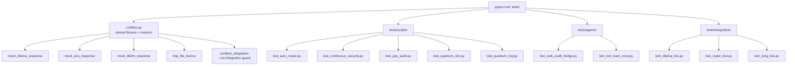
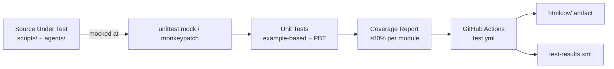

# Design Document

## Overview

The SPECTRE test suite adds automated test coverage across all core modules of the SPECTRE
security workspace. The design establishes a pytest-based directory structure with a layered
conftest fixture tree, per-module unit test files, a Hypothesis property-based test layer, and
a GitHub Actions CI workflow. Every unit test runs fully air-gapped — all external I/O (Ollama,
ANU QRNG API, LiteLLM proxy, filesystem watchers) is replaced with `unittest.mock` or
`pytest` monkeypatching. Integration tests live in a separate subdirectory and are skipped by
default behind a `--run-integration` flag.

The primary goal is deterministic, fast, air-gapped unit tests that can be run anywhere
(developer laptop, GitHub Actions runner) without Docker or local model services. Property-based
tests use Hypothesis to automatically explore edge cases across the input space of the core
logic functions.

---

## Architecture





### Design Decisions

**Why `unittest.mock` over `pytest-mock`?** The project's existing `requirements.txt` uses the
standard library. Keeping mocking in `unittest.mock` avoids an extra dependency while
`monkeypatch` handles environment variables and module-level attribute patching.

**Why Hypothesis for PBT?** Hypothesis is the de-facto Python PBT library with excellent
integration with pytest, built-in shrinking of failing examples, and a wide strategy library
that can generate strings, integers, and composite structured data. It is already listed in
`requirements-test.txt`.

**Why air-gapped unit tests?** The CI runner has no Ollama, ANU API, or LiteLLM access.
Making every unit test mock-clean eliminates flaky tests caused by external service availability.

**Why `--run-integration`?** Integration tests against live services are valuable but slow and
environment-dependent. A custom pytest CLI flag keeps the fast unit run uncontaminated without
requiring separate `pytest.ini` profiles or conftest plugins.

---

## Components and Interfaces

### Directory Structure

```
tests/
├── conftest.py                   # Root conftest: shared fixtures, markers, CLI flags
├── pytest.ini  (or pyproject.toml [tool.pytest.ini_options])
├── requirements-test.txt
├── scripts/
│   ├── __init__.py
│   ├── test_auto_router.py
│   ├── test_continuous_security.py
│   ├── test_pqc_audit.py
│   ├── test_quantum_sim.py
│   └── test_quantum_rng.py
├── agents/
│   ├── __init__.py
│   ├── test_web_audit_bridge.py
│   └── test_red_team_crew.py
└── integration/
    ├── __init__.py
    ├── conftest.py               # Integration conftest: skip guard
    ├── test_ollama_live.py
    ├── test_router_live.py
    └── test_qrng_live.py
```

### `pytest.ini` / `pyproject.toml` Configuration

```ini
[tool.pytest.ini_options]
testpaths        = ["tests"]
asyncio_mode     = "auto"
addopts          = "--cov=scripts --cov=agents --cov-report=html:htmlcov --cov-fail-under=70"
markers          = [
    "integration: mark test as requiring live local services (deselected by default)",
    "unit: mark test as a pure unit test",
    "pbt: mark test as a property-based test using Hypothesis",
]
```

The `--cov-fail-under=70` is the suite-wide floor. Per-module 80% enforcement is handled by
`pytest-cov`'s `--cov-fail-under` in the CI workflow step that targets individual modules (see
GitHub Actions section).

### `requirements-test.txt`

```
pytest==8.2.2
pytest-asyncio==0.23.8
pytest-cov==5.0.0
hypothesis==6.108.5
httpx[asyncio]==0.27.0
```

All versions pinned. No runtime dependency on `crewai`, `watchdog`, or `qiskit` — tests that
need those packages use `pytest.importorskip` or `pytest.mark.skipif`.

---

### Root `tests/conftest.py` — Fixture Design

The root conftest provides six fixture categories.

#### 1. Ollama API Mock

```python
@pytest.fixture
def mock_ollama(monkeypatch):
    """Replace urllib.request.urlopen with a fake that returns a minimal
    Ollama /api/generate JSON response. Covers continuous_security,
    pqc_audit, quantum_sim, and web_audit_bridge."""
    ...
```

`continuous_security.query_spectre_ai` and `pqc_audit.PQCAuditor.query_ai_remediation` both
use `urllib.request.urlopen`. The fixture monkeypatches `urllib.request.urlopen` at the
module level to return a `io.BytesIO`-wrapped JSON blob that matches Ollama's `/api/generate`
response schema: `{"response": "mock AI analysis", "done": true}`.

`web_audit_bridge.analyze_traffic` uses the `openai.OpenAI` client. A separate fixture
monkeypatches the `openai.OpenAI` constructor to return a `MagicMock` whose
`.chat.completions.create()` returns a fake `ChatCompletion` object.

#### 2. ANU QRNG API Mock

```python
@pytest.fixture
def mock_anu_success(monkeypatch):
    """Return a valid ANU JSON response for a given num_bytes request."""
    ...

@pytest.fixture
def mock_anu_failure(monkeypatch):
    """Simulate URLError (network unreachable) from the ANU endpoint."""
    ...
```

Both fixtures monkeypatch `urllib.request.urlopen` within the `quantum_rng` module scope
using `monkeypatch.setattr("scripts.quantum_rng.urllib.request.urlopen", ...)`.

#### 3. LiteLLM Proxy Mock

```python
@pytest.fixture
def mock_litellm(monkeypatch):
    """Intercept httpx.AsyncClient.stream to yield a fake SSE chunk."""
    ...
```

The `auto_router.route` endpoint uses `httpx.AsyncClient`. The fixture patches
`httpx.AsyncClient` via monkeypatch to return an async context manager that yields
`b'data: {"choices":[{"delta":{"content":"ok"}}]}\n\n'`.

#### 4. Temporary File Factory

```python
@pytest.fixture
def tmp_py_file(tmp_path):
    """Return a factory callable: tmp_py_file(content) -> Path.
    Writes content to a uniquely named .py file under tmp_path."""
    def _factory(content: str, suffix: str = ".py") -> Path:
        f = tmp_path / f"test_file{suffix}"
        f.write_text(content, encoding="utf-8")
        return f
    return _factory
```

Used by `test_continuous_security.py`, `test_pqc_audit.py`, and `test_web_audit_bridge.py`.

#### 5. Temporary Directory Factory

```python
@pytest.fixture
def tmp_dir_with_files(tmp_path):
    """Return a factory callable that creates a directory populated with
    named files, each with specified content."""
    def _factory(file_map: dict) -> Path:  # {"relative/path": "content"}
        for rel, content in file_map.items():
            p = tmp_path / rel
            p.parent.mkdir(parents=True, exist_ok=True)
            p.write_text(content, encoding="utf-8")
        return tmp_path
    return _factory
```

#### 6. Integration Skip Guard (in `tests/integration/conftest.py`)

```python
def pytest_runtest_setup(item):
    if item.get_closest_marker("integration"):
        if not item.config.getoption("--run-integration", default=False):
            pytest.skip("Pass --run-integration to run integration tests")
```

The custom CLI option is registered via:

```python
def pytest_addoption(parser):
    parser.addoption(
        "--run-integration",
        action="store_true",
        default=False,
        help="Run integration tests against live local services",
    )
```

---

## Data Models

### Finding Dict (`continuous_security.py`)

```python
{
    "rule_id": str,          # e.g. "SEC-001"
    "rule_name": str,
    "severity": str,         # "CRITICAL" | "HIGH" | "MEDIUM"
    "file": str,             # absolute path
    "line": int,
    "match": str,            # matched text
    "desc": str,
    "remediation": str,
    "ai_analysis": str,      # populated only when ai_assist=True
}
```

### PQC Finding Dict (`pqc_audit.py`)

```python
{
    "vuln_id": str,          # e.g. "PQC-VULN-001"
    "name": str,
    "severity": str,
    "file": str,
    "line": int,
    "match": str,
    "pqc_standard": str,
    "recommendation": str,
    "ai_remediation": str,   # populated only when enrich_with_ai called
}
```

### Burp Item Dict (`web_audit_bridge.py`)

```python
{
    "url": str,
    "method": str,
    "request": str,          # decoded body
    "response": str,         # decoded body
}
```

### Model Name Enum (logical, `auto_router.py`)

```python
VALID_MODELS = {"spectre", "architect", "atlas", "gemini-flash", "gemini-pro"}
```

---

## Per-Module Test File Design

### `tests/scripts/test_auto_router.py`

**Imports and setup:**
- `from scripts.auto_router import choose_model, has_internet, CYBERSEC_PATTERN, COMPLEXITY_PATTERN, app`
- `import httpx` and `from httpx import AsyncClient` for ASGI transport tests

**Test groups:**

1. `TestChooseModelRouting` — example-based tests for each routing rule (Requirements 2.1–2.7).
   Uses `monkeypatch.setattr("scripts.auto_router.has_internet", lambda: False/True)` to control
   connectivity without network calls.

2. `TestHealthzEndpoint` — async test using `httpx.AsyncClient(app=app, base_url="http://test")`
   to hit `/healthz` and assert status 200 and `{"status": "ok", "internet": bool}` shape
   (Requirement 2.9).

3. `TestRouteEndpoint` — async test for `/v1/chat/completions` with `mock_litellm` fixture,
   asserting the response is a streaming response (Requirement 2.8).

4. `TestChooseModelPBT` — Hypothesis property-based tests (Requirements 2.10, 2.11).

**Mocking strategy:**
- `has_internet`: `monkeypatch.setattr` with a lambda.
- LiteLLM proxy: `mock_litellm` fixture patches `httpx.AsyncClient`.
- No real sockets opened.

**Key test cases:**

```python
# 2.1 — cybersec keyword forces "spectre"
def test_cybersec_keyword_routes_to_spectre():
    body = {"messages": [{"role": "user", "content": "show me an exploit payload"}]}
    assert choose_model(body, is_private=False) == "spectre"

# 2.2 — x-spectre-private header routes to "architect"
def test_private_flag_routes_to_architect(monkeypatch):
    monkeypatch.setattr("scripts.auto_router.has_internet", lambda: True)
    body = {"messages": [{"role": "user", "content": "hello"}]}
    assert choose_model(body, is_private=True) == "architect"

# 2.3 — offline + simple prompt -> "atlas"
def test_offline_simple_routes_to_atlas(monkeypatch):
    monkeypatch.setattr("scripts.auto_router.has_internet", lambda: False)
    body = {"messages": [{"role": "user", "content": "what is 2+2"}]}
    assert choose_model(body, is_private=False) == "atlas"

# 2.4 — offline + complexity pattern -> "architect"
def test_offline_complex_routes_to_architect(monkeypatch):
    monkeypatch.setattr("scripts.auto_router.has_internet", lambda: False)
    body = {"messages": [{"role": "user", "content": "refactor the entire codebase"}]}
    assert choose_model(body, is_private=False) == "architect"

# 2.5 — online + >1000 words -> "gemini-pro"
# 2.6 — online + <50 words -> "gemini-flash"
# 2.7 — online + 50-1000 words -> "gemini-pro"
```

---

### `tests/scripts/test_continuous_security.py`

**Imports:**
- `from scripts.continuous_security import scan_file_content, scan_directory, log_findings, query_spectre_ai, SECURITY_RULES`

**Test groups:**

1. `TestScanFileContentRules` — for each SEC-001 through SEC-008: one true-positive snippet
   and one true-negative snippet using `tmp_py_file` fixture (Requirement 3.1).

2. `TestScanFileContentSpecificRules` — explicit assertions on `rule_id` and `severity` for
   SEC-001 and SEC-002 (Requirements 3.2, 3.3).

3. `TestScanFileContentEdgeCases` — self-reference exclusion (3.4), clean file (3.5).

4. `TestScanDirectory` — ignored dirs (3.6), `ai_assist=True` calls `query_spectre_ai` (3.7),
   `ai_assist=False` does not (3.8). Uses `tmp_dir_with_files` + `mock_ollama`.

5. `TestLogFindings` — Markdown entry format verification, file creation (3.9). Uses `tmp_path`.

6. `TestScanFilePBT` — Hypothesis property matching SEC-001 regex (Requirement 3.10).

**Mocking strategy:**
- `query_spectre_ai`: `monkeypatch.setattr` or `unittest.mock.patch` on
  `scripts.continuous_security.urllib.request.urlopen`.
- All file I/O via `tmp_path` — no real filesystem paths.

**SEC rule snippets (selected examples):**

```
SEC-001 positive: api_key = "EXAMPLE_sk_live_XXXXXXXXXXXXXXXXXXXX"
SEC-001 negative: api_key = "short"
SEC-002 positive: cursor.execute("SELECT * FROM users WHERE id=" + user_id)
SEC-002 negative: cursor.execute("SELECT * FROM users WHERE id = ?", (user_id,))
SEC-003 positive: os.system(user_input)
SEC-004 positive: element.innerHTML = user_data
SEC-005 positive: open(f"/data/{request.args['file']}")
SEC-006 positive: hashlib.md5(data)
SEC-007 positive: requests.get(request.args['url'])
SEC-008 positive: DEBUG = True
```

---

### `tests/scripts/test_pqc_audit.py`

**Imports:**
- `from scripts.pqc_audit import PQCAuditor, VULN_PATTERNS, SUPPORTED_EXTENSIONS, IGNORE_DIRS`

**Test groups:**

1. `TestScanFilePatterns` — for each PQC-VULN-001 through PQC-VULN-006: positive and negative
   snippets (Requirement 4.1). Creates auditor with `tmp_path` as target.

2. `TestScanFileSpecific` — explicit `vuln_id` and `severity` assertions for RSA and MD5
   (Requirements 4.2, 4.3).

3. `TestRunScan` — extension filtering (4.4) and ignored directories (4.5). Uses
   `tmp_dir_with_files` to create mixed-extension and nested-ignored-dir layouts.

4. `TestGenerateMarkdownReport` — CRITICAL finding includes "harvest now, decrypt later" (4.6),
   zero findings includes "No critical asymmetric" sentence (4.7).

5. `TestAIRemediation` — `query_ai_remediation` with Ollama unreachable returns
   `"[AI consultation unavailable"` prefix (4.8); `enrich_with_ai(ai_assist=False)` does not
   call `query_ai_remediation` (4.9).

6. `TestScanFilePBT` — non-negative finding count for random Python source (Requirement 4.10).

**Mocking strategy:**
- Ollama: `monkeypatch.setattr("scripts.pqc_audit.urllib.request.urlopen", ...)` with
  `side_effect=urllib.error.URLError("unreachable")` for the unreachable test.

**PQC snippet examples:**

```
PQC-VULN-001 positive: from Crypto.PublicKey import RSA; key = RSA.generate(2048)
PQC-VULN-001 negative: from cryptography.hazmat.primitives.asymmetric import ec
PQC-VULN-002 positive: from cryptography.hazmat.primitives.asymmetric import dh
PQC-VULN-003 positive: from Crypto.Signature import PKCS1_v1_5
PQC-VULN-004 positive: from cryptography.hazmat.primitives.asymmetric.ed25519 import Ed25519PrivateKey
PQC-VULN-005 positive: cipher = AES.new(key, AES.MODE_CBC, key_size=128)
PQC-VULN-006 positive: import hashlib; h = hashlib.md5(data)
PQC-VULN-006 negative: import hashlib; h = hashlib.sha256(data)
```

---

### `tests/scripts/test_quantum_sim.py`

**Imports:**
- `from scripts.quantum_sim import StatevectorSim, run_bell_state_demo, run_grover_demo, run_shor_toy_demo, run_lwe_demo`
- `import math`

**Test groups:**

1. `TestStatevectorSimGates` — Hadamard on |0⟩ (5.1), Hadamard self-inverse (5.2), Bell state
   via H+CNOT (5.3). All use `pytest.approx` with `abs=1e-9`.

2. `TestBellStateDemo` — measurement counts check (5.4).

3. `TestGroverDemo` — success rate >80% for valid targets in [2,4] qubits (5.5).

4. `TestShorToyDemo` — N=15, a=7 returns `rsa_broken==True` with factors [3,5] (5.6);
   N=15, a=3 returns error key without exception (5.7).

5. `TestLWEDemo` — noise in {-1,0,1}, b in [0, q-1] (5.8).

6. `TestGroverPBT` — Grover lower-bound invariant (Requirement 5.9).

7. `TestNormalisationPBT` — probability sum invariant (Requirement 5.10).

**No mocking required** — `StatevectorSim` is pure Python with no external I/O. Demo functions
use `urllib.request` only in `consult_oracle_ai`, which is not exercised in unit tests.

**Gate sequence generation for PBT:**

```python
from hypothesis import given, settings
from hypothesis import strategies as st

GATE_CHOICES = ["apply_hadamard", "apply_pauli_x"]

@given(
    num_qubits=st.integers(min_value=1, max_value=6),
    gates=st.lists(
        st.tuples(st.sampled_from(GATE_CHOICES), st.integers(min_value=0, max_value=5)),
        max_size=10,
    )
)
@settings(max_examples=100)
def test_probability_normalisation(num_qubits, gates):
    sim = StatevectorSim(num_qubits)
    for gate_name, qubit in gates:
        qubit = qubit % num_qubits  # clamp to valid range
        getattr(sim, gate_name)(qubit)
    assert abs(sum(sim.get_probabilities()) - 1.0) < 1e-9
```

---

### `tests/scripts/test_quantum_rng.py`

**Imports:**
- `from scripts.quantum_rng import (fetch_anu_quantum_bytes, generate_local_quantum_jitter_entropy, get_quantum_entropy, generate_aes256_gcm_bundle, generate_pqc_seed_bundle, generate_session_tokens)`

**Test groups:**

1. `TestFetchANUQuantumBytes` — success path (6.1), network error returns None (6.2).
   Uses `mock_anu_success` and `mock_anu_failure` fixtures.

2. `TestLocalJitterEntropy` — exact length for n in [1,512] example cases (6.3); ValueError
   on n=0 and n=-1 (6.11).

3. `TestGetQuantumEntropy` — `force_offline=True` does not call ANU mock (6.4);
   `force_offline=False` with ANU failure falls back to local entropy (6.5).

4. `TestBundleGenerators` — AES-256 GCM bundle shape/format (6.6); PQC seed bundle
   length/format (6.7).

5. `TestSessionTokens` — count and length assertions for example cases (6.8); character
   set validation (URL-safe base64).

6. `TestJitterEntropyPBT` — length invariant (Requirement 6.9).

7. `TestSessionTokensPBT` — count and length invariants (Requirement 6.10).

**Mocking strategy:**
- ANU API: `monkeypatch.setattr("scripts.quantum_rng.urllib.request.urlopen", ...)` returning
  a `io.BytesIO` wrapping `json.dumps({"success": True, "data": list(range(n))}).encode()`.
- `force_offline=True` tests do not need any mock — they skip the network path entirely.

---

### `tests/agents/test_web_audit_bridge.py`

**Imports:**
- `from agents.web_audit_bridge import parse_burp_xml, analyze_traffic`

**Test groups:**

1. `TestParseBurpXML` — N items returns N dicts with required keys (7.1); base64 decoding
   of request/response (7.2); invalid UTF-8 base64 uses `errors="replace"` (7.3); missing
   tags return empty string (7.4); non-existent file raises `FileNotFoundError` (7.5).

2. `TestMainFileNotFound` — `main()` catches `FileNotFoundError`, prints message, exits
   cleanly (7.6). Uses `capsys` and `monkeypatch.setattr("sys.argv", ...)`.

3. `TestAnalyzeTraffic` — Ollama called exactly once (7.7); Ollama exception returns
   `"Error analyzing request:"` prefix (7.8).

**Mocking strategy:**
- `openai.OpenAI`: `monkeypatch.setattr("agents.web_audit_bridge.CLIENT", mock_client)`
  where `mock_client` is a `MagicMock` with `.chat.completions.create` returning a
  `SimpleNamespace(choices=[SimpleNamespace(message=SimpleNamespace(content="ok"))])`.
- XML fixtures use `tmp_py_file` with `.xml` suffix or inline `io.StringIO`.

**Burp XML fixture helper:**

```python
def make_burp_xml(items: list[dict]) -> str:
    """Build minimal Burp XML string from list of item dicts.
    Each dict may have keys: url, method, request (raw str), response (raw str),
    request_b64 (bool), response_b64 (bool).
    """
```

---

### `tests/agents/test_red_team_crew.py`

**Module-level skip guard:**

```python
crewai = pytest.importorskip(
    "crewai",
    reason="crewai not installed; skipping Red Team Crew tests"
)
```

**Imports** (after importorskip):
- `from agents.red_team_crew import create_red_team_crew`

**Test groups:**

1. `TestCreateRedTeamCrew` — exactly 4 agents (8.1); task order and agent assignment (8.2);
   `allow_delegation=False` for all (8.3); target string in `recon_task.description` (8.4).

**Mocking strategy:**
- `langchain_community.llms.Ollama`: `monkeypatch.setattr` at module level to return a
  `MagicMock`. Without this, the `Ollama()` constructors in `red_team_crew.py` attempt
  to connect to `localhost:11434`.
- Alternative: patch `agents.red_team_crew.Ollama` before import completes using a
  module-level `pytest.fixture(autouse=True)` that monkeypatches the class.

**Agent role matching:**

```python
EXPECTED_ROLES = [
    "Reconnaissance Specialist",
    "Exploit Developer",
    "Security Code Reviewer",
    "Lead Penetration Tester",
]

def test_crew_has_four_agents(crew):
    assert len(crew.agents) == 4

def test_agent_roles(crew):
    for agent, expected in zip(crew.agents, EXPECTED_ROLES):
        assert expected in agent.role
```

---

### `tests/integration/` Layout

**`test_ollama_live.py`** (Requirement 9.4, 9.5):

```python
@pytest.mark.integration
async def test_atlas_responds():
    import httpx
    health = httpx.get("http://localhost:11434/api/tags", timeout=5)
    if health.status_code != 200:
        pytest.skip("Ollama unreachable")
    # send real completion request and assert response content length >= 1
```

**`test_router_live.py`** (Requirement 9.6):

```python
@pytest.mark.integration
async def test_exploit_routes_to_spectre():
    async with httpx.AsyncClient(app=app, base_url="http://test") as client:
        # points to real LiteLLM at localhost:4000
        resp = await client.post("/v1/chat/completions", json={...exploit keyword...})
        assert resp.status_code == 200
```

**`test_qrng_live.py`** (Requirement 9.7):

```python
@pytest.mark.integration
def test_anu_api_returns_bytes_or_none():
    result = fetch_anu_quantum_bytes(32)
    assert result is None or (isinstance(result, bytes) and len(result) == 32)
```

---

## Correctness Properties

*A property is a characteristic or behavior that should hold true across all valid executions of a system — essentially, a formal statement about what the system should do. Properties serve as the bridge between human-readable specifications and machine-verifiable correctness guarantees.*

### Property 1: choose_model output is always a valid model name

*For any* message body dict and any boolean `is_private` value, `choose_model(body, is_private)` shall return a string that is a member of `{"spectre", "architect", "atlas", "gemini-flash", "gemini-pro"}`.

**Validates: Requirements 2.10**

### Property 2: Cybersecurity keyword routing invariant

*For any* message body whose concatenated message content contains at least one word matching the `CYBERSEC_PATTERN` regex, `choose_model(body, is_private=False)` shall return `"spectre"`.

**Validates: Requirements 2.11**

### Property 3: SEC-001 scanner output matches regex

*For any* string drawn from the character classes `[A-Za-z0-9_\-\.]`, if the string matches the SEC-001 compiled regex then `scan_file_content` on a synthetic single-line file containing that string shall return exactly one finding with `rule_id == "SEC-001"`, and if the string does not match the SEC-001 regex then `scan_file_content` shall return an empty list.

**Validates: Requirements 3.10**

### Property 4: PQCAuditor.scan_file never returns a negative count

*For any* string of length between 0 and 10,000 characters written to a temporary `.py` file, `PQCAuditor.scan_file` shall return a list whose length is greater than or equal to zero and shall not raise an unhandled exception.

**Validates: Requirements 4.10**

### Property 5: Grover quadratic speedup lower-bound invariant

*For any* `num_qubits` in `[2, 5]` and any `target_state` in `[0, 2^num_qubits - 1]`, `run_grover_demo(target_state=target_state, num_qubits=num_qubits)` shall return a dict where `success_rate_percent >= 50.0`.

**Validates: Requirements 5.9**

### Property 6: Quantum statevector probability normalisation

*For any* number of qubits in `[1, 6]` and any sequence of at most 10 gates drawn from `{apply_hadamard, apply_pauli_x}` applied to valid qubit indices, `StatevectorSim.get_probabilities()` shall return a list of floats that sums to `1.0` within a tolerance of `1e-9`.

**Validates: Requirements 5.10**

### Property 7: Local jitter entropy length invariant

*For any* integer `n` in `[1, 512]`, `generate_local_quantum_jitter_entropy(n)` shall return a `bytes` object whose `len()` equals `n`.

**Validates: Requirements 6.9**

### Property 8: Session token count and length invariants

*For any* integer `count` in `[1, 100]` and integer `length` in `[16, 256]`, `generate_session_tokens(count=count, length=length)` shall return a list of exactly `count` strings each of exactly `length` characters.

**Validates: Requirements 6.10**

---

## Error Handling

### External Service Failures

| Service | Affected Module | Failure Mode | Expected Behaviour |
|---|---|---|---|
| Ollama API (urllib) | `continuous_security`, `pqc_audit`, `quantum_sim` | `urllib.error.URLError` | Return `None` or `"[AI consultation unavailable..."` string |
| Ollama API (openai SDK) | `web_audit_bridge` | Any `Exception` | Return `"Error analyzing request: <msg>"` |
| ANU QRNG API | `quantum_rng` | `urllib.error.URLError` or HTTP error | Return `None`; caller falls back to local jitter entropy |
| LiteLLM proxy | `auto_router` | `httpx` connection error | Propagate as HTTP 502 (not tested at unit level) |

### File System Errors

| Scenario | Module | Behaviour |
|---|---|---|
| Unreadable file in `scan_file_content` | `continuous_security` | `except Exception: return []` |
| Non-existent XML path | `web_audit_bridge` | `ET.parse` raises `FileNotFoundError`; `main()` catches it |
| Log file parent dir missing | `continuous_security` | `log_findings` must create the file (tested in Requirement 3.9) |

### Input Validation Errors

| Input | Module | Behaviour |
|---|---|---|
| `n <= 0` | `quantum_rng.generate_local_quantum_jitter_entropy` | Raise `ValueError` |
| `N=15, a=3` (gcd != 1) | `quantum_sim.run_shor_toy_demo` | Return dict with `"error"` key, no exception |
| Empty XML `<items>` | `web_audit_bridge.parse_burp_xml` | Return `[]` |

---

## Testing Strategy

### Dual Testing Approach

The suite uses both example-based unit tests and property-based tests (Hypothesis) as
complementary layers:

- **Example-based unit tests** verify specific behaviours, exact output shapes, error messages,
  and call counts. They are fast, deterministic, and easy to debug.
- **Property-based tests** generate hundreds of random inputs to find edge cases that
  example-based tests miss. They verify universal invariants across the full input space.

### Property-Based Testing Configuration

The chosen PBT library is **Hypothesis** (v6.108.5+). Each property test is tagged with a
comment referencing the design property it validates.

```python
# Feature: spectre-test-suite, Property 1: choose_model output is always a valid model name
@given(
    body=st.fixed_dictionaries({
        "messages": st.lists(
            st.fixed_dictionaries({
                "role": st.sampled_from(["user", "assistant"]),
                "content": st.text(max_size=5000),
            }),
            max_size=10,
        )
    }),
    is_private=st.booleans(),
)
@settings(max_examples=100)
def test_choose_model_always_valid(body, is_private, monkeypatch):
    monkeypatch.setattr("scripts.auto_router.has_internet", lambda: False)
    result = choose_model(body, is_private)
    assert result in {"spectre", "architect", "atlas", "gemini-flash", "gemini-pro"}
```

All property tests use `@settings(max_examples=100)` as the minimum. Tests that are
computationally cheap (e.g., `generate_local_quantum_jitter_entropy`) may use up to 200.

### Unit Testing Conventions

- One `assert` per logical concept (avoid test logic that masks failures).
- Use `pytest.approx` for all floating-point comparisons.
- Use `tmp_path` / fixture factories for all file I/O; never write to real paths.
- Patch at the narrowest scope: prefer `monkeypatch.setattr("module.under.test.dependency")`
  over patching the source module of the dependency.
- Async tests use `@pytest.mark.asyncio` (or rely on `asyncio_mode = "auto"` in config).
- Call count assertions use `MagicMock.assert_called_once_with(...)` or
  `MagicMock.call_count == N`.

### Coverage Targets

| Module | Minimum Line Coverage |
|---|---|
| `scripts/auto_router.py` | 80% |
| `scripts/continuous_security.py` | 80% |
| `scripts/pqc_audit.py` | 80% |
| `scripts/quantum_sim.py` | 80% |
| `scripts/quantum_rng.py` | 80% |
| `agents/web_audit_bridge.py` | 80% |
| `agents/red_team_crew.py` | Skipped if crewai absent |
| Suite-wide floor | 70% |

### GitHub Actions CI Workflow — `.github/workflows/test.yml`

```yaml
name: SPECTRE Test Suite

on:
  push:
    branches: ["**"]
  pull_request:
    branches: ["main", "develop"]

jobs:
  unit-tests:
    name: Unit Tests (air-gapped)
    runs-on: ubuntu-latest

    steps:
      - name: Checkout repository
        uses: actions/checkout@v4

      - name: Set up Python 3.11
        uses: actions/setup-python@v5
        with:
          python-version: "3.11"

      - name: Install test dependencies
        run: pip install -r requirements-test.txt

      - name: Run unit tests with coverage
        run: |
          pytest \
            --cov=scripts \
            --cov=agents \
            --cov-report=html:htmlcov \
            --cov-report=xml:coverage.xml \
            --cov-fail-under=70 \
            --junitxml=test-results.xml \
            -v \
            --ignore=tests/integration

      - name: Check per-module coverage (80% threshold)
        run: |
          python - <<'EOF'
          import xml.etree.ElementTree as ET, sys
          MODULES = [
              "scripts/auto_router.py",
              "scripts/continuous_security.py",
              "scripts/pqc_audit.py",
              "scripts/quantum_sim.py",
              "scripts/quantum_rng.py",
              "agents/web_audit_bridge.py",
          ]
          tree = ET.parse("coverage.xml")
          root = tree.getroot()
          failed = []
          for pkg in root.iter("class"):
              fname = pkg.attrib.get("filename", "")
              for mod in MODULES:
                  if fname.endswith(mod.replace("/", "\\")) or fname.endswith(mod):
                      cov = float(pkg.attrib.get("line-rate", "0")) * 100
                      if cov < 80.0:
                          failed.append(f"{fname}: {cov:.1f}% < 80%")
          if failed:
              print("Coverage below 80% for:", *failed, sep="\n  ")
              sys.exit(1)
          print("All per-module coverage checks passed.")
          EOF

      - name: Upload HTML coverage report
        if: always()
        uses: actions/upload-artifact@v4
        with:
          name: coverage-report
          path: htmlcov/

      - name: Upload JUnit test results
        if: always()
        uses: actions/upload-artifact@v4
        with:
          name: test-results
          path: test-results.xml
```

The workflow:
1. Runs on every push and pull request.
2. Uses no Docker services — no Ollama, LiteLLM, or GPU required.
3. Integration tests are excluded via `--ignore=tests/integration`.
4. The per-module 80% check parses `coverage.xml` directly; if any configured source
   directory cannot be found or causes an import error, `pytest` itself exits non-zero
   before reaching that step (satisfying Requirement 10.7).
5. Both `htmlcov/` and `test-results.xml` are uploaded as artifacts for every run
   (including failures) via `if: always()`.
